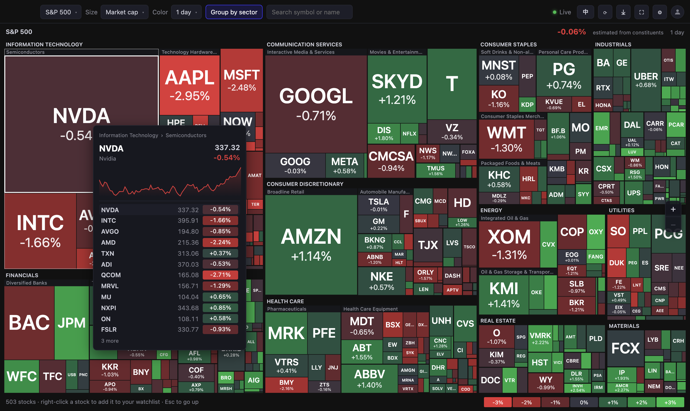

# Schwab Heatmap

A desktop stock-market heatmap for macOS, powered by your own [Charles Schwab Trader API](https://developer.schwab.com) account. The layout and interactions follow the familiar TradingView-style heatmap: tiles grouped by sector and industry, sized by market cap, colored by performance, updating live.

[中文说明](README.zh-CN.md)



<sub>Screenshot taken in demo mode: the prices are synthetic.</sub>

> **Not affiliated** with Charles Schwab, TradingView, Nasdaq or Zacks. You need your own Schwab developer app, and market data is for your personal use under Schwab's terms. Nothing here is investment advice.

## Features

- **Stock lists**: Nasdaq-100, Nasdaq Composite (~3,400), Dow Jones Composite / Industrials / Transportation / Utilities, KBW Nasdaq Bank, S&P 500, all US-listed companies (~5,800), your watchlist, and your Schwab holdings.
- **ETF holdings maps**: SMH, QQQM, XLP and VOO by default. Add, remove and reorder ETFs; tiles are sized by fund weight.
- **Live quotes** over the Schwab Streamer (WebSocket), with batched REST snapshots and polling for anything past the streaming cap.
- **Periods**: 1 day, pre/after-market, 1 week, 1/3/6 months, year to date, 1 year. Long periods are computed from daily history and stay live with each tick.
- **Sizing**: market cap, equal weight, volume, dollar volume, fund weight (ETFs) or position value (holdings).
- **Page summary**: the official index or the ETF's own move and price, or a weighted estimate from constituents where no index quote exists. Holdings show total value, return and day P/L.
- **Navigation**: click to drill into a sector or industry, scroll-wheel zoom around the cursor, drag to pan, +/−/reset buttons, search highlighting, legend filtering, PNG export.
- **Watchlist**: right-click any stock to add or remove it (watchlist tiles get a ★), or search ~7,000 US stocks by ticker or company name.
- **Holdings** refresh within seconds of an order fill (Schwab account-activity stream), with Schwab's own day P/L.
- **One GICS taxonomy** across all lists, in **English and Chinese** (switch with the EN / 中 button).
- **Optional Google sign-in** syncs your watchlist, ETF list and view preferences across Macs (bring your own Firebase project).

## Requirements

- macOS on Apple Silicon (the packaging script builds arm64; development works anywhere Electron runs)
- Node.js 20 or newer
- A Schwab brokerage account and a [Schwab developer](https://developer.schwab.com) app approved for **Market Data Production** (and Accounts and Trading if you want the holdings map)

## Quick start

```bash
git clone <this repo>
cd schwab-heatmap
npm install
npm run dev
```

The first `npm run dev` also compiles the stock-list data (see [Data sources](#data-sources)); this takes a few seconds and needs internet access.

Then, in the app:

1. Open **Settings** (⚙, top right) and enter your Schwab app's **App Key**, **Secret** and **Callback URL**. The callback must match your app registration exactly, for example `https://127.0.0.1`.
2. Click **Log in to Schwab** and finish the login in the window that opens. The app captures the OAuth redirect itself, so there's no local HTTPS server to set up.
3. Schwab refresh tokens last 7 days; Settings shows when you need to log in again.

Your Schwab secret and tokens are stored only on your Mac, encrypted with the macOS keychain (`safeStorage`).

### Demo mode

To try the UI without a Schwab account:

```bash
HEATMAP_DEMO=1 npm run dev
```

Prices are synthetic. Add `HEATMAP_USER_DATA=/some/tmp/dir` to run it beside a real instance without sharing storage.

### Install into /Applications

```bash
npm run install-app
```

This builds the app, signs it ad hoc and copies it to `/Applications/Schwab Heatmap.app`. Run it again after pulling updates. The installed app and `npm run dev` share the same data directory (`~/Library/Application Support/schwab-heatmap`), so you stay logged in; don't run both at once. The first time the installed app reads your secret, macOS may ask for keychain access: choose **Always Allow**.

## Optional: Google sign-in and cloud sync

Signing in with Google syncs your watchlist, ETF list and view preferences (language, default list, period, sizing, grouping) across machines. Schwab credentials and login state are never synced. This needs a Firebase project of your own; the free tier is plenty.

1. Create a project in the [Firebase console](https://console.firebase.google.com).
2. **Authentication → Sign-in method**: enable **Google**.
3. **Firestore Database → Create database** (production mode), then publish these rules:

   ```
   rules_version = '2';
   service cloud.firestore {
     match /databases/{database}/documents {
       match /users/{uid} {
         allow read, write: if request.auth != null && request.auth.uid == uid;
       }
     }
   }
   ```

4. **Project settings → Your apps**: add a **Web app** and note its `apiKey` and `projectId`.
5. In the [Google Cloud console](https://console.cloud.google.com/apis/credentials) for the same project:
   - **OAuth consent screen**: External, keep it in **Testing**, and add your Gmail address as a test user.
   - **Credentials → Create credentials → OAuth client ID**: type **Desktop app**; note the client ID and secret.
6. Copy `cloud.config.example.json` to `cloud.config.json` and fill in the four values. This file is git-ignored and is bundled into the app when you package it.

Sign-in opens your system browser (Google doesn't allow embedded webviews) and uses a one-off loopback redirect with PKCE. Without `cloud.config.json` the account features are simply hidden.

> The packaged app includes `cloud.config.json`. These values aren't true secrets, and the Firestore rules keep each user's data private, but don't hand your build to others unless you're fine with them using your Firebase project.

## Data sources

Schwab's API has no index constituents or sector data, so the stock lists are compiled from public pages by `npm run universes` (run automatically before `dev` and `dist` when files are missing). The output in `resources/universes/` is **not checked in**.

| Data | Source |
|---|---|
| S&P 500 members, GICS sectors and sub-industries | Wikipedia |
| Nasdaq-100, Nasdaq Composite, KBW Nasdaq Bank members | Nasdaq index weightings (indexes.nasdaqomx.com) |
| Dow Jones Industrials / Transportation / Utilities | Wikipedia |
| All US stocks, classification of non-S&P stocks, fallback share counts | Nasdaq stock screener |
| ETF holdings and weights | Zacks fund holdings pages (cached locally, at most once per trading day) |
| Quotes, daily history, intraday charts, share counts, positions | Schwab Trader API |

The Nasdaq screener's 153 industries are mapped onto GICS in `src/shared/taxonomy.ts`, so every list shares one set of sectors and industries. The ETF holdings come from scraping a web page and may break if Zacks changes its site; the app then keeps the last cached copy.

## How it works

- **Electron + React + TypeScript.** The main process (`src/main`) owns OAuth, the Schwab REST client, the Streamer connection and all caching. The renderer (`src/renderer`) lays out the treemap with `d3-hierarchy` and draws it on a canvas.
- **Rate limits.** Schwab allows 120 market-data requests per minute. The app uses 110, split into three priority lanes: *interactive* (hover charts, a list's first load, positions), *refresh* (re-polls, share counts; leaves 30 slots per minute free) and *bulk* (daily-history sync, paced evenly; leaves 60 free). Requests time out after 15 seconds.
- **Streaming cap.** The Streamer accepts about 3,000 symbols. Subscriptions are ordered benchmark first, then by market cap, so only the smallest companies fall back to a 2-minute batch poll.
- **Daily history.** The first sync fetches one year of daily bars per symbol (about 10 minutes for the S&P 500, a couple of hours for all US stocks). After that, the batch quotes the app loads anyway carry each day's new close, so daily updates need no extra requests. Gaps, likely splits and a weekly full refresh still refetch.
- **Switching lists** waits for fresh quotes by default, so a map is never drawn from minutes-old prices. **Settings → Display** can switch instantly from cached prices instead, marked "Updating quotes…" until they're refreshed.
- **Diagnostics.** Phase timings and slow requests are appended to `perf.log` in the data directory (durations and counts only).

## Development

```bash
npm test            # unit tests (vitest)
npm run typecheck
npm run universes   # rebuild the stock-list data
npm run icon        # regenerate build/icon.icns
npm run dist        # package dist/mac-arm64/Schwab Heatmap.app (unsigned)
```

## License

[MIT](LICENSE)
