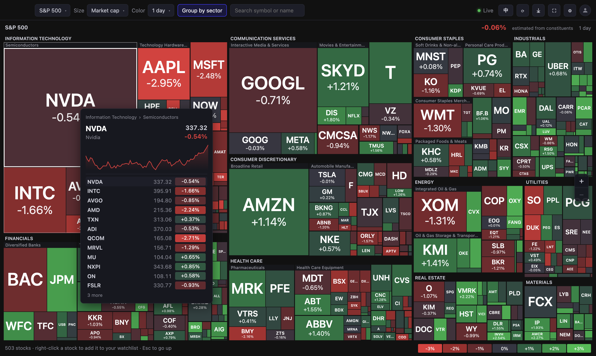

# Schwab Heatmap

macOS 上的股票热图桌面 App。行情数据来自你自己的 Schwab Trader API 账号，界面和交互参考 TradingView 风格的股票热图。

[English](README.md)



> 本项目与 Charles Schwab、TradingView、Nasdaq、Zacks 均无关联。你需要自己的 Schwab 开发者 App，行情数据按 Schwab 条款仅限个人使用。本项目不构成任何投资建议。

## 首次运行

```bash
npm install
npm run dev
```

第一次运行 `npm run dev` 时，会先自动生成股票池数据（见下文「数据从哪来」），需要联网，大约几秒钟。

1. 点右上角 ⚙ 打开设置，填入 developer.schwab.com 上 App 的 **App Key**、**Secret**、**Callback URL**（要和注册时一字不差，比如 `https://127.0.0.1`）。
2. 点「登录 Schwab」，在弹出的窗口里完成登录和授权。App 会自动截获回调里的 code，不需要在本地起 https 服务。
3. Schwab 的 refresh token 有效期是 7 天，到期后要重新登录（设置页里会显示剩余天数）。

不登录也想看界面的话：`HEATMAP_DEMO=1 npm run dev`（使用合成数据）。如果同时还开着另一个实例，再加上 `HEATMAP_USER_DATA=/某个临时目录`，两边就不会共用存储。

## 安装到「应用程序」

```bash
npm run install-app
```

这条命令会打包、做 ad-hoc 签名，然后把 App 复制到 `/Applications/Schwab Heatmap.app`；以后更新代码也是重新跑这一条。安装版和 `npm run dev` 用的是同一个数据目录（`~/Library/Application Support/schwab-heatmap`）和同一个钥匙串密钥，所以不用重新登录。两者不要同时运行。安装版第一次读取 Secret 时，macOS 可能会弹窗询问是否允许访问钥匙串，选「始终允许」即可。

图标由 `npm run icon` 生成，输出到 `build/icon.icns`。

## Google 账号与云同步（可选）

登录 Google 账号后，自选股和界面偏好（语言、默认股票池、颜色周期、方块大小、是否分组）会在登录同一账号的电脑之间同步。Schwab 的 Key、Secret 和登录状态不同步，每台电脑各自登录 Schwab。

需要先在 Firebase 做一次设置（免费额度足够个人使用）：

1. 打开 [Firebase 控制台](https://console.firebase.google.com)，新建项目（Google Analytics 可以关掉）。
2. **Authentication → Sign-in method**：启用 **Google**。
3. **Firestore Database → 创建数据库**：选生产模式，区域可选 `asia-east1`（台湾）或 `asia-northeast1`（东京）。建好后在「规则」页粘贴下面这段并发布：

   ```
   rules_version = '2';
   service cloud.firestore {
     match /databases/{database}/documents {
       match /users/{uid} {
         allow read, write: if request.auth != null && request.auth.uid == uid;
       }
     }
   }
   ```

4. **项目设置 → 常规 → 你的应用**：添加一个 **Web 应用**，记下配置里的 `apiKey` 和 `projectId`。
5. 打开 [Google Cloud Console](https://console.cloud.google.com/apis/credentials)，在顶部选择同一个项目：
   - **OAuth 同意屏幕**：用户类型选「外部」，保持「测试」状态，并把自己的 Gmail 加为测试用户；
   - **凭据 → 创建凭据 → OAuth 客户端 ID**：应用类型选「**桌面应用**」，记下客户端 ID 和客户端密钥。
6. 把 `cloud.config.example.json` 复制为 `cloud.config.json`，填入以上四个值，然后运行 `npm run install-app`。这个文件会被打包进 App，并已加入 `.gitignore`。

之后在 App 里点右上角的人像按钮（或 ⚙ 设置）→「使用 Google 登录」。系统浏览器会打开 Google 登录页，完成后回到 App 即可。Google 不允许在 App 内嵌的窗口里登录，所以要走浏览器。登录状态长期有效，不需要每周重新登录。

访问 Google 服务需要能连上 Google。App 的云同步请求走系统代理，和 Chrome 一致。

没有 `cloud.config.json` 时，账号功能自动隐藏，其他功能照常使用。

## 功能

- 股票池（顺序和 TradingView「美国」列表一致）：Nasdaq-100、纳斯达克综合（约 3400 只）、道琼斯综合 / 工业 / 运输 / 公用事业、KBW Nasdaq 银行、标普 500、所有美国公司（约 5800 只），以及自选和持仓（来自 Schwab 账户）。Russell 系列暂不提供：官方成分股是付费数据
- ETF 成分股热图：下拉菜单里的「ETF」分组（默认 SMH、QQQM、XLP、VOO），在「⚙ 管理 ETF…」里增删和排序；方块大小默认按 ETF 持仓权重。成分股和权重来自 Zacks 的持仓页面，每只 ETF 每个交易日最多抓取一次并缓存在本地；拿不到时沿用上次的缓存。ETF 列表和自选一样会云同步
- 中英文界面：右上角的「EN / 中」按钮切换，板块、行业名称会跟着切换（例如「金融」/「FINANCIALS」）
- 方块面积：市值、等权、成交量、成交额；ETF 页面默认按 ETF 权重，持仓页面默认按持仓市值。颜色：1 天、盘前/盘后、1 周、1 个月、3 个月、6 个月、年初至今、1 年
- 页面顶部显示整页在所选周期内的涨跌：指数页用官方指数点位，ETF 页用 ETF 本身的价格；Schwab 没有行情的指数改用成分股估算。自选页同时给出等权和市值加权两种结果，持仓页显示总市值、收益率和盈亏金额。下钻后还会显示当前板块或行业的涨跌
- 板块 → 行业分组；点击下钻，Esc 或面包屑返回上一级
- 缩放：滚轮以光标为中心缩放，放大后左键拖动平移；右侧有 + / − / ⟲ 按钮，快捷键为 `+` `-` `0`
- 自选：在任意热图里右键股票即可加入或移出，自选里的股票方块带 ★；在「自选」页可以搜索添加（支持一次粘贴多个代码）
- 持仓：盘中成交后几秒内自动刷新（订阅 Schwab 账户动态推送，另有每 60 秒和切回窗口时的兜底刷新）。「1 天」的盈亏使用 Schwab 的当日盈亏
- 悬停浮层：所在行业的股票列表和走势小图；悬停图例的某一档，只高亮落在这一档的股票
- 按代码或名称搜索高亮，导出 PNG，全屏
- 行情通过 Schwab Streamer（LEVELONE_EQUITIES）实时推送；多周期涨跌幅用日线历史计算，标普 500 首次同步约 5 分钟（受 120 次/分 的限流约束）。之后按交易日缓存在本地，同步时按市值从大到小进行

## 数据从哪来

Schwab 不提供指数成分股和行业分类，所以：

- S&P 500 成分股和 GICS 板块/子行业：Wikipedia
- Nasdaq-100、纳斯达克综合、KBW 银行指数：Nasdaq 指数官网（indexes.nasdaqomx.com）
- 道琼斯工业：Wikipedia 上的公司名单，再和 S&P 500 对照出代码；运输、公用事业：Wikipedia 表格；综合指数 = 三者合并
- 所有美国公司、非 S&P 股票的分类、各股股本（作为备用）：Nasdaq 选股器。它的 153 种行业由 `src/shared/taxonomy.ts` 映射到 GICS，所以所有股票池共用同一套板块和行业

股票很多的股票池（纳斯达克综合、所有美国公司），第一次同步 1 周以上周期所需的日线要比较久，所有美国公司大约 2 小时，按市值从大到小进行。之后每天的新收盘价直接从批量报价里补上，不需要额外请求。Schwab Streamer 最多实时推送约 3000 只股票：订阅时基准指数排在第一位，其余按市值从大到小，超出部分（都是小盘股）改为每 2 分钟用批量报价刷新。鼠标悬停在右上角「实时」上可以看到数量。

股票池数据输出到 `resources/universes/`，**不提交到 git**。`npm run dev` 和 `npm run dist` 发现文件缺失时会自动生成，也可以手动运行 `npm run universes` 重新生成，或者在 App 里点 ⟳ 刷新（刷新后的数据存在用户数据目录，优先级高于打包进 App 的那份）。ETF 成分股来自 Zacks 网页，属于网页抓取，网站改版后可能失效，届时会沿用上次的缓存。

切换股票池时默认等最新报价拉完再切换，保证看到的不是旧价格；在「设置 → 显示」里可以改成先用缓存数据立即切换，并显示「正在更新报价…」。

请求限流分三档：交互（悬停走势图、首次打开、持仓）、刷新（轮询、股本，给交互留 30 次/分）、批量（日线同步，匀速，给上面两档留 60 次/分），每个请求 15 秒超时。各阶段耗时和慢请求会记录到数据目录下的 `perf.log`，只包含耗时和计数。

市值 = Schwab instruments 接口返回的 `sharesOutstanding` × 实时价格。

## 开发

```bash
npm test          # vitest 单测
npm run typecheck
npm run dist      # 打包 dist/mac-arm64/Schwab Heatmap.app（未签名）
```

主进程（`src/main`）负责 OAuth、REST 限流、Streamer 和本地缓存；渲染进程（`src/renderer`）用 d3-hierarchy 计算 treemap 布局，再画到 Canvas 上。

Schwab 行情数据仅供个人使用，请勿对外分发。

## 协议

[MIT](LICENSE)
